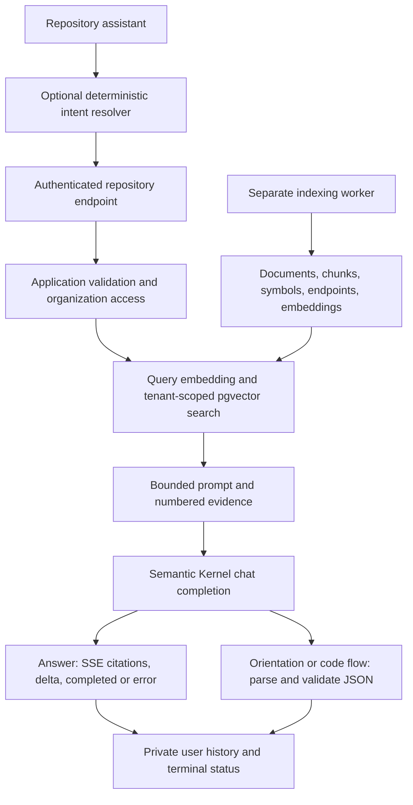

# AI engineering gap analysis

Audit date: 2026-10-15. Baseline: `bc5efb6c52899776ccfdaf9dd59e58830f1fd36d`, matching local and remote `main` at inspection.

This is a source and backlog audit, not a live model benchmark or production security certification. No paid inference, private repository export, or deployment was performed. The supplied AI Engineering Maturity Roadmap is planning input; the findings below distinguish implemented behavior from proposed work.

## Architecture and current request path

The existing .NET application already provides the product foundation. Domain entities and Application use cases remain independent of Infrastructure implementations. API, Worker, and Migrator are separate hosts; React provides the workspace. Preserve these boundaries.

For the Answer path:

1. [RepositoryAssistant.tsx](../src/RepoNavAI.Web/src/repositories/RepositoryAssistant.tsx) chooses Search, Answer, Orientation, or CodeFlow. Auto uses a [keyword-based intent resolver](../src/RepoNavAI.Application/Repositories/RepositoryAssistantFeatures.cs), not an agent. The client sends cancellation through its abort signal.
2. [RepositoriesController](../src/RepoNavAI.Api/Controllers/RepositoriesController.cs) accepts an authenticated POST to `/{repositoryId}/chat`. `StreamRepositoryChatHandler` in [RepositoryFeatures.cs](../src/RepoNavAI.Application/Repositories/RepositoryFeatures.cs) validates the question, checks organization membership and repository access, obtains a snapshot reference, and starts session/history records.
3. `IEmbeddingGenerator` embeds the question. `PgVectorStore` in [SemanticSearch.cs](../src/RepoNavAI.Infrastructure/Repositories/SemanticSearch.cs) independently selects the latest snapshot, filters by organization, ranks by cosine distance, and returns eight chunks for Answer. There is no explicit reranker or relevance cutoff here.
4. [RepositoryChat.cs](../src/RepoNavAI.Infrastructure/Repositories/RepositoryChat.cs) builds a character-bounded evidence prompt. It marks repository content as untrusted, requests numbered citations, and calls `IChatCompletionService` with temperature 0.2 and configured output limits.
5. The application emits citation metadata and answer deltas; the controller flushes SSE events. React renders answer text and application-created source links. The generator exposes text only, discarding other provider response metadata at this boundary.
6. The handler finalizes private assistant history and session status. Saved user results are not an execution trace or evaluation record.

Search ends after retrieval. [Orientation](../src/RepoNavAI.Application/Repositories/RepositoryOrientationFeatures.cs) retrieves up to 20 results and validates plan steps/citation numbers. [Code flow](../src/RepoNavAI.Application/Repositories/RepositoryCodeFlowFeatures.cs) uses three deterministic retrieval queries, deduplicates to at most 20 chunks, and validates structured steps and citations. Neither is a model-directed tool loop.

## What exists and what is missing

| Area | Verified implementation | Remaining gap |
| --- | --- | --- |
| Tenant boundaries | Organization checks precede retrieval/generation; queries and private history carry tenant scope | Reuse these checks for every future tool and MCP entry point; test cross-tenant attempts through the real storage path |
| Indexing | Separate Worker, PostgreSQL leases, heartbeats, restart recovery, bounded archives, cancellation and attempts | Correlate enqueue, worker attempt, acquisition and embedding; do not rebuild the queue |
| Logging and metrics | Serilog request/exception logs; acquisition histograms and failure counter under `RepoNavAI.Indexing.Acquisition` | No application-owned AI `ActivitySource`, trace exporter configuration, or unified retrieval/model run record found |
| Context | Deterministic chunks, ranked retrieval, character limits, untrusted-evidence framing | Record exactly which evidence survives selection/truncation, actual ranges, ordering, and prompt/retrieval versions |
| Models | Configurable embedding/chat models, fixed 512-dimensional vector schema, bounded output; Semantic Kernel connector behind application ports | No provider usage capture or normalized call/retry diagnostics; changing embedding configuration needs version compatibility rules |
| Reliability | Two-minute embedding HTTP timeout; explicit code-flow timeout; propagated cancellation; sanitized public errors; bounded indexing retries | Chat/orientation lack an application-owned end-to-end deadline; SDK retry defaults are not explicitly configured or verified here; streaming replay policy and fault classification need tests |
| Usage limits | Rolling organization request cap in chat-session store for Answer and CodeFlow; bounded history storage | Search and Orientation use different paths without this session quota; no shared token/call budget or cost ledger |
| Evidence validation | Application-created immutable links; structured plan/flow citation index checks and evidence-level checks | Answer citation mentions are not validated against the assembled prompt; a valid link does not prove the associated claim |
| Product history | Private saved prompts/results, stars, retention, schema versions, commit staleness | Not full context, model parameters, usage, intermediate calls, evaluator output, or reproducible run provenance |
| Tooling and agents | Search, endpoints, stored source and C# symbol extraction can support tools | No explicit model-callable tool registry, dispatcher, MCP endpoint, or bounded agent loop found |
| Tests and CI | xUnit, FluentAssertions, mocked HTTP/provider tests, API tests, Vitest, Playwright, docs and container checks | No versioned AI evaluation dataset, repeated-run reports, calibrated judge, or AI regression gate found |
| Language support | [SourceLanguageRegistry](../src/RepoNavAI.Infrastructure/Repositories/SourceLanguageRegistry.cs) indexes many source/configuration languages | Current symbol parser is C#; ASP.NET endpoint analysis and architecture maps are not general semantic reference resolution |

Evidence for instrumentation and wiring: [API startup](../src/RepoNavAI.Api/Program.cs), [dependency injection](../src/RepoNavAI.Infrastructure/DependencyInjection.cs), [indexing pipeline](../src/RepoNavAI.Infrastructure/Repositories/IndexingPipeline.cs), and [package versions](../Directory.Packages.props). Library-internal telemetry may exist; this audit does not establish that it is collected or safe by default.

## Highest-value risks to reproduce

These are code-derived risks, not measured failure frequencies. Turn each into a controlled fixture before claiming a runtime failure or improvement.

1. **Retrieved evidence is not necessarily model-visible evidence.** The prompt builders can omit or truncate chunks, but Answer citations and structured citation validation use the original source list. A selected-context manifest should distinguish candidates, supplied excerpts, and citations actually used. SourceChunker also caps characters without adjusting its declared end line; range checks should cover truncated chunks.
2. **Snapshot selection is not atomic across a run.** Handlers read a latest snapshot reference, while each vector search independently selects the latest snapshot. A concurrent re-index can change the selected commit. CodeFlow filters mismatched results afterward; this does not guarantee stable retrieval across its three searches. Pin one authorized, retrieval-ready snapshot and its embedding configuration for the whole run.
3. **Failures and expense are hard to attribute.** Embedding responses retain only vector data; generation ports expose text or parsed drafts without usage. Generic errors and SDK defaults cannot distinguish retrieval failure, truncation, invalid structure, provider throttling, or cancellation reliably. Capture stage outcomes and usage availability before optimizing.
4. **Existing automated tests do not establish RAG quality.** [SemanticSearchTests](../tests/RepoNavAI.Api.IntegrationTests/SemanticSearchTests.cs) exercise chunking and a recording HTTP handler. [OrganizationEndpointsTests](../tests/RepoNavAI.Api.IntegrationTests/OrganizationEndpointsTests.cs) substitute vector/provider/storage services. These are useful tests, but they do not measure real pgvector ranking, model grounding, or repeated-run reliability.

Prompt delimiters and model instructions are controls, not proof of injection resistance. Include malicious repository text, fabricated citations, insufficient evidence, non-web repositories, cancellation and provider faults in the evaluation plan.

## Documentation and backlog reconciliation

The README reflects newer capabilities than the previous steering document. Worker separation, orientation, code flow, capability-aware navigation, removal, themes, and architecture maps already exist. Azure Bicep, migration jobs and promotion workflows exist in source; live environment provisioning was not verified. [Assistant history](product/assistant-history.md) supersedes ADR-007's original metadata-only persistence description for user-facing saved results, but does not authorize logging those contents.

GitHub open-issue inspection on 2026-10-15 returned #48, #77, #85, #90, #91 and #93. No open tracing/evaluation initiative appeared in that result. Preserve the Apple/Microsoft rollout items (#90/#91, P1); propose scheduling the new AI foundations ahead of the P2 visual work (#77/#85/#93). The guide discovery #48 has no priority/size labels in the issue response; verify its board fields if it is reactivated. No issues or project fields were changed during this audit.

The repository still targets `net9.0`. Microsoft lists .NET 9 end of support as **November 10, 2026** and .NET 10 as LTS. Add a separately reviewed runtime/dependency upgrade before that deadline; this is maintenance, not an application rewrite. [Microsoft support policy](https://dotnet.microsoft.com/en-us/platform/support/policy/dotnet-core)

## Recommended starting point

Implement a privacy-safe trace boundary for the existing Search/Answer path first, then instrument structured generation and indexing using the same contract. Build a small pinned dataset alongside that work. Use the resulting traces to review real failures before introducing tools, MCP, or agent behavior. See the [delivery roadmap](ai-engineering-roadmap.md) and [first-increment issue drafts](development/ai-engineering-work-items.md).
